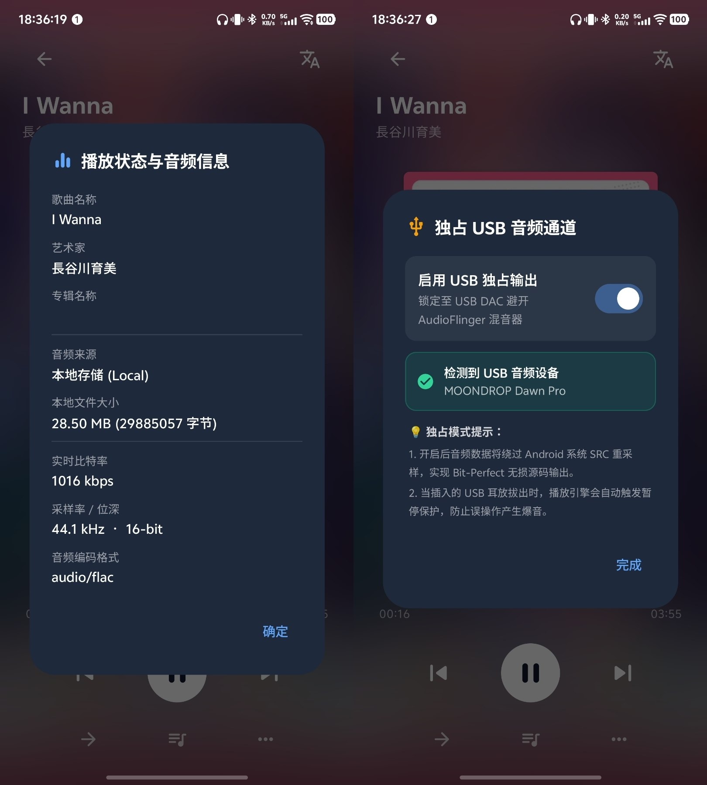
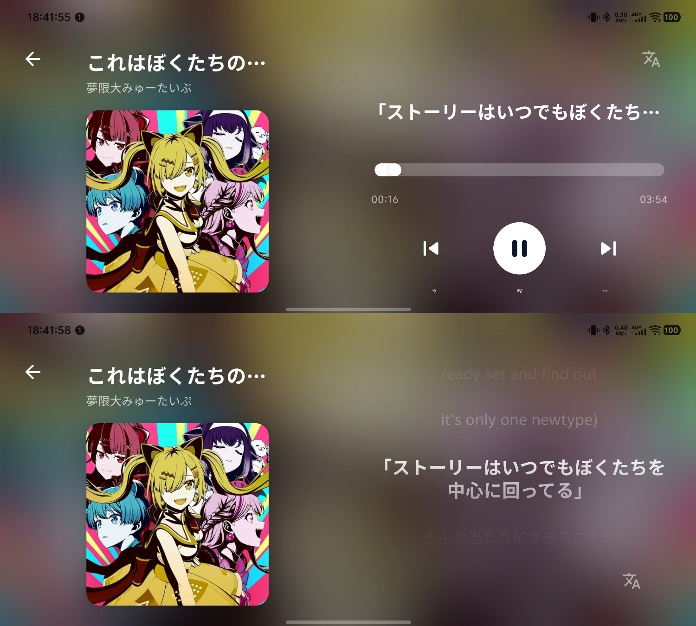
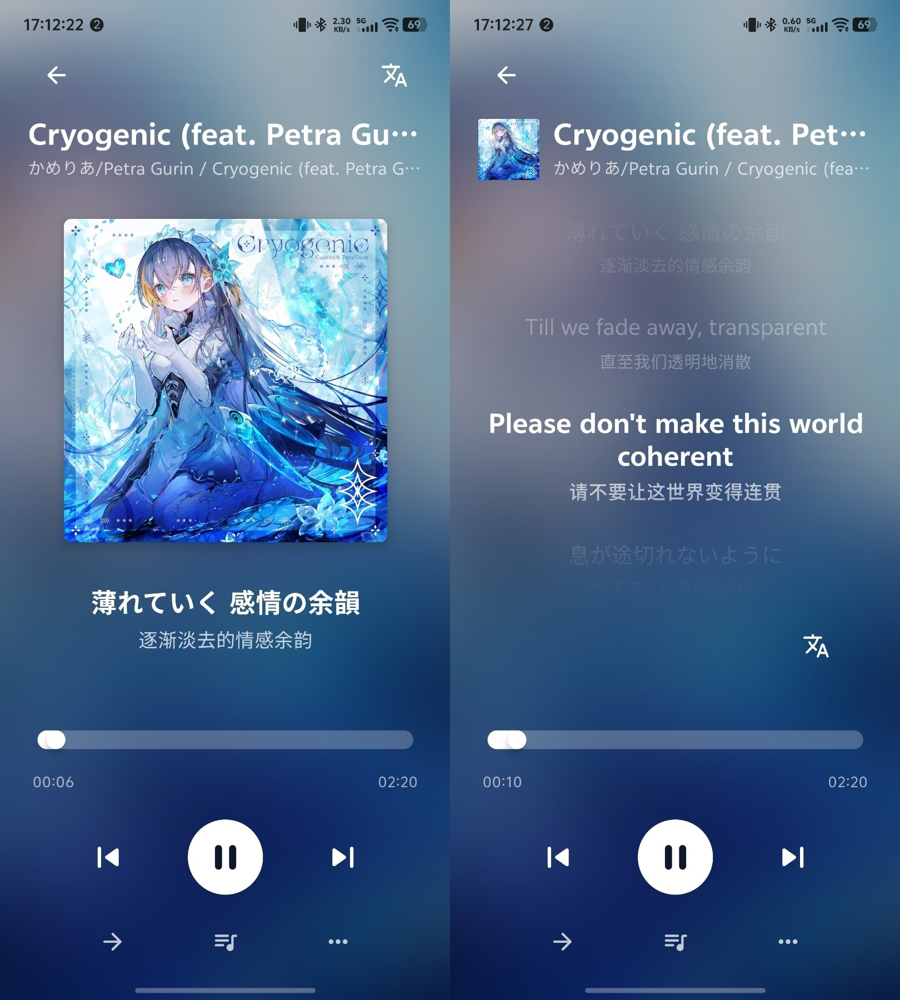
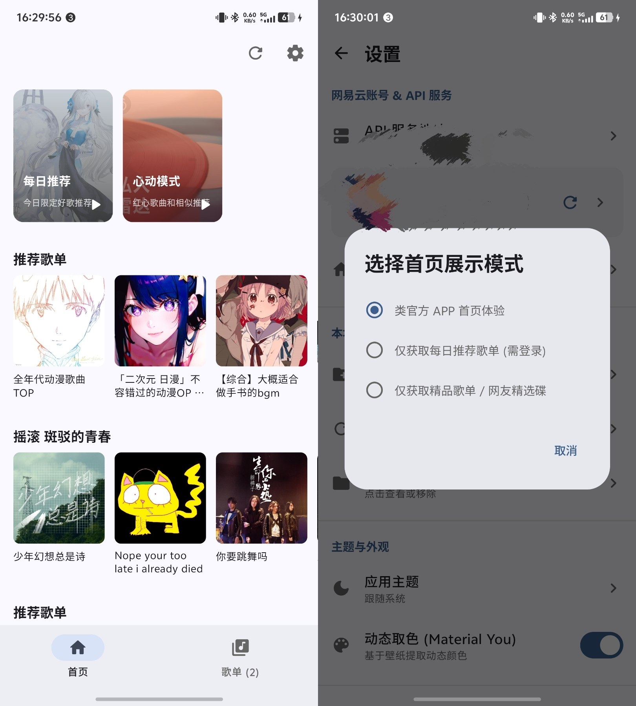
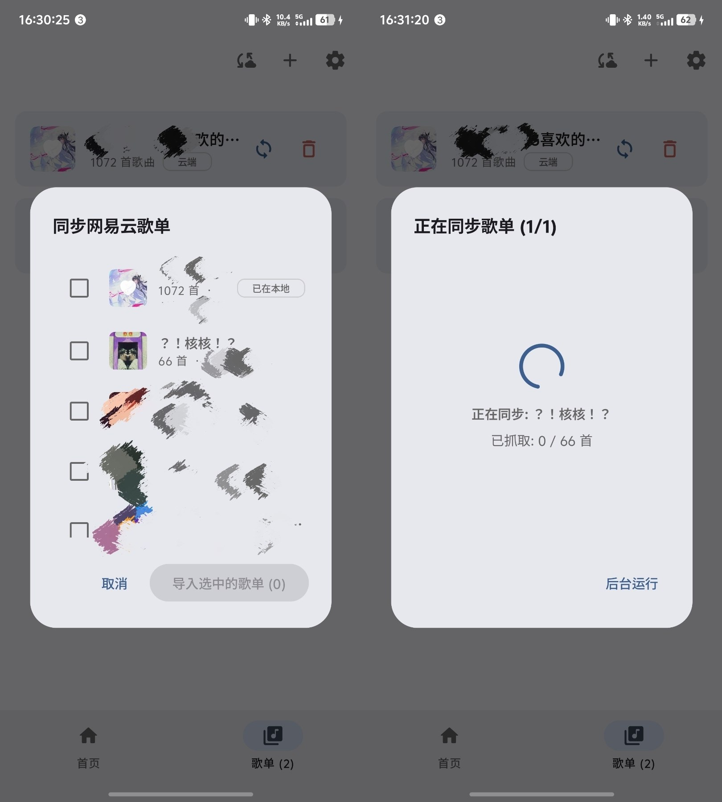
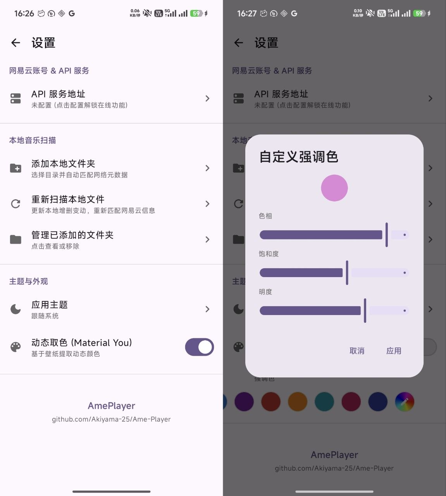
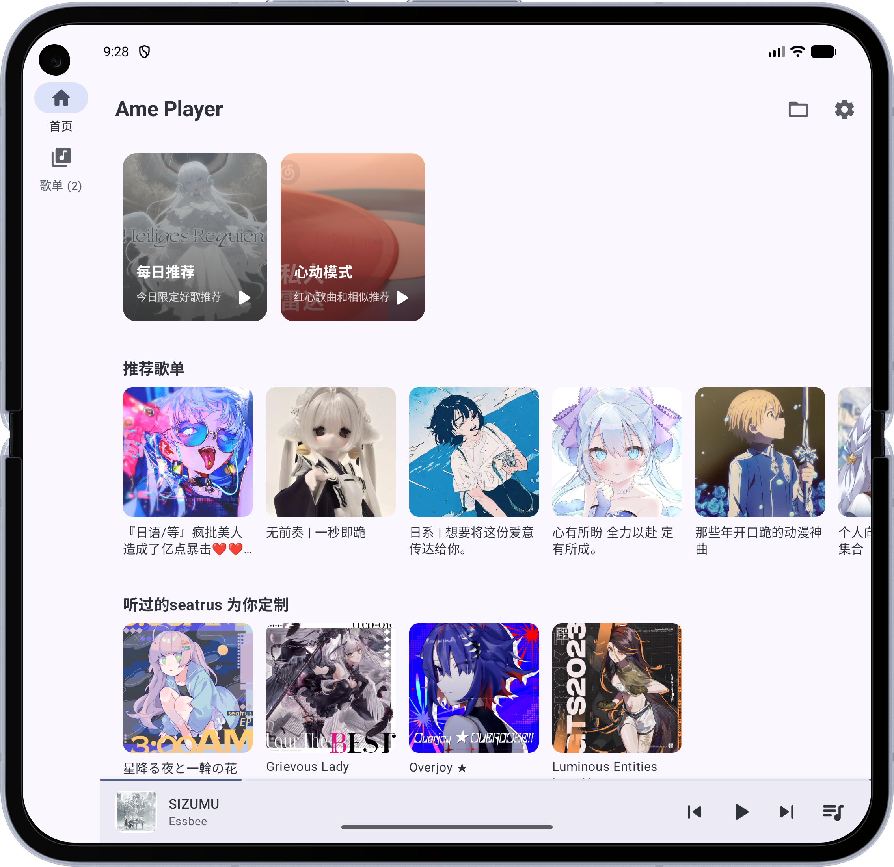
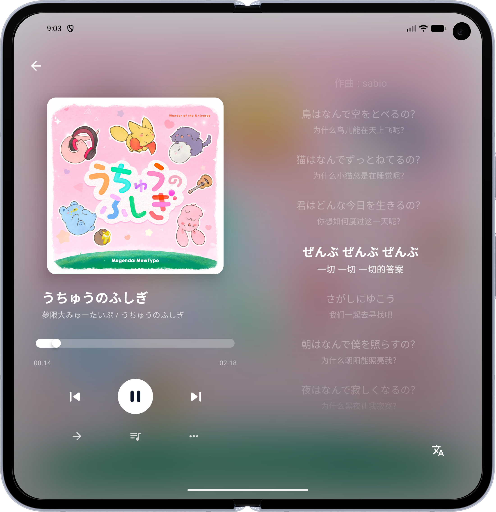
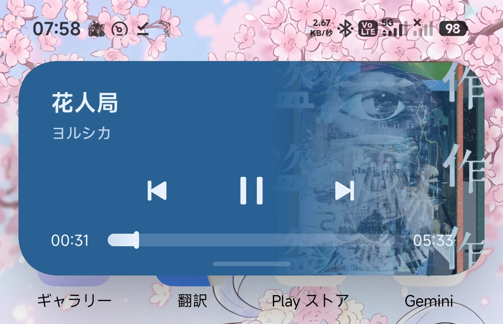
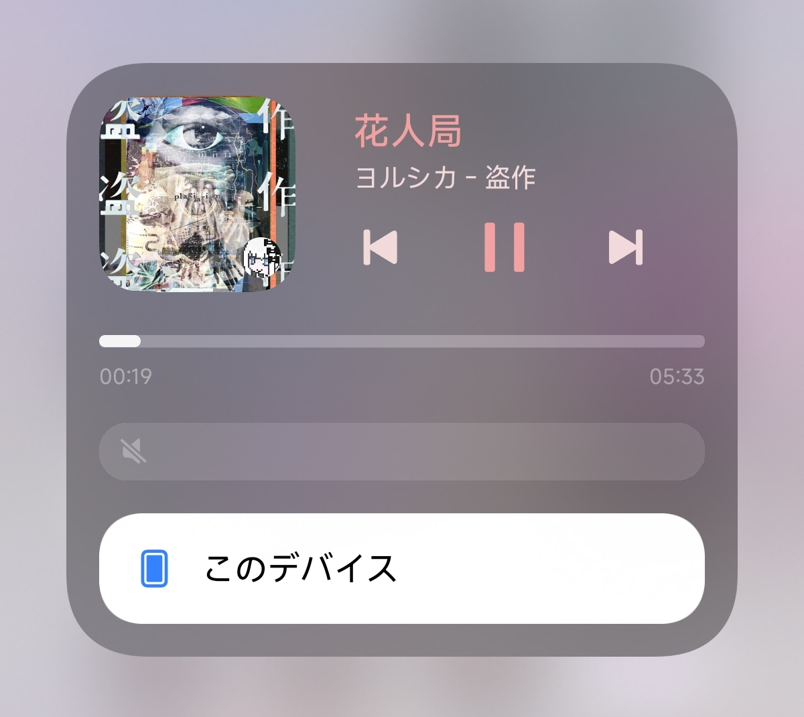

<div align="center">
  
  <h1>AmePlayer</h1>
  <p>基于 Jetpack Compose 与 Media3 (ExoPlayer) 构建的高品质 Android 音乐播放器，内置原生网易云音乐加密直连客户端，支持在线流媒体播放、本地音频管理与 NCM 加密文件解密，深度集成 Material 3 Adaptive 自适应布局、（实验性）系统级实况通知（灵动岛/流体云/超级岛）与 USB DAC 硬件直通输出。</p>
</div>

<p align="center">
  
  
  
  
</p>
<p align="center">
  
  
  
  
</p>
<p align="center">
  
  
</p>

- 部分截图来自早期开发版本
- HyperOS 上岛效果不代表实际效果，如需达到，请在设备安装 LSPosed 后，使用 [Hyper Helper](https://github.com/HowieHChen/XiaomiHelper) 修改

---

## 目录

- [项目简介](#项目简介)
- [功能概览](#功能概览)
- [架构与模块](#架构与模块)
- [环境要求](#环境要求)
- [构建与运行](#构建与运行)
- [本地与云端匹配机制](#本地与云端匹配机制)
- [调试与诊断支持](#调试与诊断支持)
- [技术栈](#技术栈)
- [鸣谢](#鸣谢)
- [许可声明](#许可声明)

---

## 项目简介

AmePlayer 是一款面向 Android 平台的音乐播放器应用。项目以「高保真音频播放」与「网易云音乐生态深度整合」为核心定位，旨在为用户提供兼具本地与在线的一站式音乐体验。

主要设计目标：

- **免外部服务的原生直连**：内置纯 Kotlin 实现的网易云音乐 `WeAPI` 与 `EAPI` 加解密协议层（`NeteaseDirectClient` / `NeteaseCrypto`），无需额外部署 Node.js 后端即可直连官方接口；同时保留自定义 API 后端回退能力。
- **跨设备自适应**：借助 Material 3 Adaptive Navigation Suite，在手机竖屏、横屏、折叠屏及平板等不同形态下自动切换最佳导航与布局方案。
- **发烧级音频直通**：内置 USB DAC 独占模式，绕过 Android AudioFlinger 重采样链路，实现 Bit-Perfect 原始码流输出。
- **网易云全链路整合**：通过扫码登录账户，双向同步云端歌单与“我喜欢的音乐”，自动协商并获取当前账户权限所允许的最高音质（Hi-Res / 无损 / 高品质）。
- **NCM 格式兼容与流式优化**：支持解密网易云客户端下载的 `.ncm` 加密音频文件，内置 FLAC Header 缓存与帧同步优化，自动通过 API 补全缺失的元数据信息。
- **系统级实况播放窗**：深度适配 Android Media3 `MediaSessionService` 与 Android 16 实况通知（Live Updates），联动澎湃焦点岛/超级岛、ColorOS 流体云、OriginOS 原子岛及 Flyme 状态栏实况歌词。

---

## 功能概览

### 播放引擎与音频

| 功能 | 说明 |
|------|------|
| 在线流媒体播放 | 解析网易云 CDN 真实 MP3/FLAC 播放链接，自动按序协商最高音质（`hires` → `lossless` → `exhigh` → `standard`） |
| 本地音频播放 | 支持通过系统文件选择器（SAF）选取多个本地目录进行批量扫描与增量刷新 |
| NCM 文件解密与 FLAC 流优化 | 自动识别并流式解密 `.ncm` 格式加密文件；通过 `FlacHeaderCacheDataSource` 缓存 FLAC 元数据块，提升无损音频定位与起播速度 |
| USB DAC 独占直通 | 绕过 AudioFlinger SRC 重采样，实现 Bit-Perfect 输出；设备拔出时自动暂停保护 |
| 智能歌词匹配 | 根据音频元数据检索网易云曲库，拉取原文与翻译双语同步歌词 |

### 网易云音乐集成（原生加密直连 + 兼容后端）

| 功能 | 说明 | 登录要求 |
|------|------|----------|
| 原生 WeAPI / EAPI 直连 | 内置 AES/RSA/MD5 协议加解密与请求签名，开箱即用直连网易云官方接口 | — |
| 扫码授权登录 | 官方二维码状态机轮询，自动提取并清洗 `Set-Cookie` 持久化保存 | — |
| 用户信息获取与刷新 | 拉取昵称、头像、VIP 等级与个人主页信息，启动时自动静默刷新 | 需登录 |
| 云端歌单同步 | 拉取用户创建和收藏的歌单，基于完整 `trackIds` 分页加载长歌单曲目 | 需登录 |
| 歌单曲目双向同步 | 本地对歌单的增删曲目操作实时同步至云端并校验服务端响应 | 需登录 |
| 喜欢 / 取消喜欢 | 红心曲目状态实时同步 | 需登录 |
| 每日推荐与首页聚合 | 支持类官方 APP 首页（Dragon Ball 入口 + 动态 Block 推荐）、每日推荐歌单/歌曲、精品歌单等多种展示模式，支持本地首页缓存 | 部分功能需登录 |

### 灵动岛与系统级实时播放控制

| 功能 | 说明 |
|------|------|
| 标准 MediaSession 媒体控制窗 | 基于前台服务 `AmePlaybackService` 与非硬件位图解码器（`CoilSessionBitmapLoader`），向系统提供高清专辑封面、进度条及上一首/播放暂停/下一首快捷控制 |
| 多厂商实况窗适配 | 适配 Xiaomi HyperOS 澎湃焦点岛/超级岛、OPPO ColorOS 流体云、vivo OriginOS 原子岛（含 `superx` 扩展参数与节流保护）及 Samsung One UI Now Bar |
| Android 16 实况通知支持 | 支持 Android 16 (API 36) `canPostPromotedNotifications` 晋升权限检查与一键跳转系统实况通知设置 |
| Flyme 状态栏歌词 | 内置 `FlymeTickerLyricHelper`，支持注入 `FLAG_ALWAYS_SHOW_TICKER` 与 `FLAG_ONLY_UPDATE_TICKER` 状态栏歌词标记 |
> 在OriginOS 6上已证实失败~（恼~

### 界面与交互

- **Material 3 Adaptive 自适应导航**：基于 `NavigationSuiteScaffold`，紧凑屏幕（< 600dp）使用底部 `NavigationBar`，中等及以上屏幕（≥ 600dp）切换为左侧 `NavigationRail`，设置页自动切换单列/双列网格。
- **响应式首页网格布局**：使用 `GridCells.Adaptive` 根据窗口断点动态调整列数（Compact 2-3 列 / Medium 4-5 列 / Expanded 6-8 列），卡片尺寸随断点自动缩放。
- **全局过渡动画**：基于 Compose `AnimatedContent` 实现页面间平滑过渡，包括播放页上拉/下拉、设置页侧滑、Tab 交叉淡入淡出及歌单详情景深推进等。
- **Material You 动态主题**：完整适配 Monet 引擎的系统取色；关闭动态取色时自动捕获并固化当前系统色调，内置预设强调色与 HSL 调色盘供手动指定。
- **歌曲操作菜单**：通过底部弹出面板（Bottom Sheet）提供“下一首播放”、“喜欢/取消喜欢”、“加入/移出歌单”等操作，操作结果实时同步至云端。

---

## 架构与模块

项目采用单模块结构，包名为 `Akari.NCM.player`，按职责划分为以下子包：

```text
app/src/main/java/Akari/NCM/player/
├── api/          # 网易云网络层（NcmApi 门面、NeteaseDirectClient 直连传输、NeteaseCrypto 加解密、NeteaseEndpoints 路由）
├── core/         # 核心数据模型、播放状态定义与分级日志系统（AppLogger）
├── data/         # 数据源与持久化（NcmDataSource、FlacHeaderCacheDataSource、PlaylistManager、LocalFolderManager、UsbAudioManager、UserSessionManager、ThemePrefs）
├── di/           # Hilt 依赖注入模块（AppModule）
├── player/       # 音频播放引擎与前台媒体服务（AmePlayerEngine、AmePlaybackService、MediaMetadataHelper）
│   └── island/   # 灵动岛/实况通知与多厂商状态栏歌词扩展（IslandLiveNotificationManager、FlymeTickerLyricHelper）
└── ui/           # Compose UI 层（MainScreen、PlayerScreen、SettingsScreen、UserHomepageView、公共组件与动态主题）
```

---

## 环境要求

| 项目 | 版本要求 |
|------|----------|
| Android Studio | Ladybug (2024.2) 或更高版本 |
| JDK | 21 |
| Gradle | 9.5 |
| Android compileSdk | 36 |
| Android minSdk | 26 (Android 8.0) |
| Android targetSdk | 35 |
| Kotlin | 2.2.10（与 Compose Compiler / KSP 对应版本） |

---

## 构建与运行

### 本地构建

1. 克隆仓库：
   ```bash
   git clone https://github.com/Akiyama-25/Ame-Player.git
   cd Ame-Player
   ```

2. 使用 Android Studio 打开项目，等待 Gradle 同步完成后，选择目标设备并点击 **Run** 即可。

3. 命令行构建与测试：
   ```bash
   # 构建 Debug APK
   ./gradlew assembleDebug

   # 构建 Release APK（支持启用 ABI 分包：arm64-v8a、armeabi-v7a 与 universal）
   ./gradlew assembleRelease -PenableAbiSplits=true

   # 运行本地 JVM / Robolectric 单元测试套件
   ./gradlew testDebugUnitTest
   ```

### CI / CD 自动构建与签名发布

仓库已配置两条 GitHub Actions 工作流：

- **`.github/workflows/build-signed-apk.yml`**：在 `main` 分支推送、PR 或手动触发时自动运行单元测试并构建多架构 Release APK（`arm64-v8a`、`armeabi-v7a`、`universal`），在配置签名 Secrets 后自动执行 `zipalign` 与 `apksigner` 签名校验并上传构件。
- **`.github/workflows/release-signed-apk.yml`**：在推送任意版本标签（Tag）或手动指定标签名称时自动构建、签名、生成 `SHA256SUMS.txt` 校验文件并发布至 GitHub Releases。

---

## 本地与云端匹配机制

应用在加载云端歌单时，会自动与「本地扫描文件夹」中已索引的音频进行匹配。匹配成功的曲目将在歌单中显示本地标记（✓），播放时优先读取本地文件以减少流量消耗并降低加载延迟。

### 匹配策略

1. **精确 ID 匹配**：含有 `musicId` 元数据的 NCM 文件通过唯一 ID 直接关联。
2. **文本特征匹配（Fallback）**：对于普通 MP3/FLAC 文件，提取音频标签中的 `"歌名 - 歌手"` 进行标准化处理（忽略大小写、统一括号与常见连接符）后交叉比对。若本地文件缺失标签，则尝试以文件名通过网易云 API 进行搜索匹配。

### 歌单匹配状态快速筛选

在 **设置 → 调试功能 → 歌曲匹配列表查看** 中开启开关后，进入任意歌单详情页即可在顶部看到筛选标签栏：
- **全部 (总数)**
- **已匹配 (已匹配本地源数量)**
- **未匹配 (未匹配数量)**

支持一键过滤查看已关联或未关联本地文件的曲目，且在筛选视图下点击歌曲或“播放全部”仍能准确映射原始曲目索引与本地资源。

### 已知边缘情况

| 场景 | 说明 |
|------|------|
| 多歌手分隔符不一致 | 云端通常以 `/` 拼接（如 `A / B`），本地可能使用 `,` 或仅标注主唱，导致文本不匹配 |
| 歌名附加后缀差异 | 云端歌名携带 `(Live)`、`(Remaster)`、`(feat. xxx)` 等后缀而本地标签无此信息 |
| 全角/半角字符与标点差异 | 特殊引号、中英文符号及简繁体差异可能影响精确匹配 |
| 无标签文件的 API 兜底误判 | 文件名不规范时（如 `track_01.mp3`），API 搜索可能返回错误结果，导致误匹配 |
| 同名曲目覆盖 | 同时存在原唱与伴奏且标签完全相同时，后扫描的文件将覆盖前者的映射关系 |
| MPEG/MP3 本地翻唱与电台曲目 | 当本地音频为网易云电台、播客或未官方收录的翻唱时，基于官方单曲库的 API 搜索会匹配失败，此时将退回提取本地 ID3 封面，且可能无法获取到正确的歌词 |

---

## 调试与诊断支持

应用内置完整的本地日志记录与导出工具（`AppLogger`），便于排查网络请求、音频解码或设备兼容性问题：

- **分级日志控制**：在 **设置 → 调试功能 → 日志记录** 中单击可切换日志级别（`VERBOSE` / `DEBUG` / `INFO` / `WARN` / `ERROR`，默认为 `ERROR`）。
- **大小限制与自动轮转**：长按“日志记录”设置项可自定义单文件大小上限（默认 `1024 KB`）。超出上限时自动滚动备份至 `app_log.1.txt`，避免占用过多存储空间。
- **崩溃异常捕获**：内置全局未捕获异常处理器（`UncaughtExceptionHandler`），应用发生异常崩溃时自动记录完整堆栈至本地日志。
- **多格式一键导出**：点击“导出”按钮可将当前运行日志导出并通过系统分享面板发送为：
  - `.log`：纯文本原始日志
  - `.md`：包含导出时间、日志等级、大小上限与代码块的 Markdown 诊断文档
  - `.zip`：标准压缩归档包

---

## 技术栈

### UI 与界面框架
- Jetpack Compose（声明式 UI）
- Material 3 + Material 3 Adaptive (`adaptive`, `adaptive-layout`, `adaptive-navigation`, `material3-adaptive-navigation-suite`)
- Coil（图片异步加载与 MediaSession 封面解码）
- ZXing Core（登录二维码本地渲染）

### 多媒体引擎
- AndroidX Media3 (`media3-exoplayer`, `media3-datasource`, `media3-session`, `media3-database`)
- `ResolvingDataSource` + 自定义 `NcmDataSource` / `FlacHeaderCacheDataSource`

### 网络与加密
- Ktor Client (`OkHttp` 引擎 + `ContentNegotiation`)
- Kotlinx.Serialization (JSON)
- Android 原生 `javax.crypto` / `java.security`（AES-128-CBC / AES-128-ECB / RSA / MD5 网易云协议加解密）

### 依赖注入与并发
- Hilt + KSP
- Kotlin Coroutines & Flow

### 自动化测试
- Robolectric（本地 JVM 环境下的 Android 与 Compose UI 自动化测试）
- AndroidX Compose UI Test (JUnit 4)
- 覆盖范围：`NeteaseCryptoTest`、`NeteaseEndpointsTest`、`PlaylistMatchingTest`、`IslandAndMetadataTest`、`AdaptiveNavigationTest`、`HomepageAdaptiveGridTest`、`HomepageCacheTest`、`AppLoggerTest`、`DebugFeaturesAndMatchFilterTest`

---

## 鸣谢

- **[NeteaseCloudMusicApi Enhanced](https://github.com/NeteaseCloudMusicApiEnhanced/api-enhanced)** — 提供网易云音乐 API 结构参考与兼容后端支持。
- **[rinchao0721/Melodia](https://github.com/rinchao0721/Melodia)** — 提供了 App 内嵌纯 Kotlin 加密直连网易云官方 API 的架构思路与协议参考。
- **应用图标来源** — [kanae3792 (Pinterest)](https://jp.pinterest.com/kanae3792/)

---

## 许可声明

本项目采用 [GPL-3.0 License](LICENSE) 开源，仅供技术学习与交流使用，请勿用于任何商业用途。

**项目地址**：[https://github.com/Akiyama-25/Ame-Player](https://github.com/Akiyama-25/Ame-Player)
