# AmePlayer

简体中文

<div align="center">
  
  <p>基于 Jetpack Compose 与 Media3 (ExoPlayer) 构建的 Android 音乐播放器，内置纯 Kotlin 网易云音乐加密直连客户端，支持在线流媒体播放、本地音频管理与 NCM 加密文件流式解密。</p>
</div>

<p align="center">
  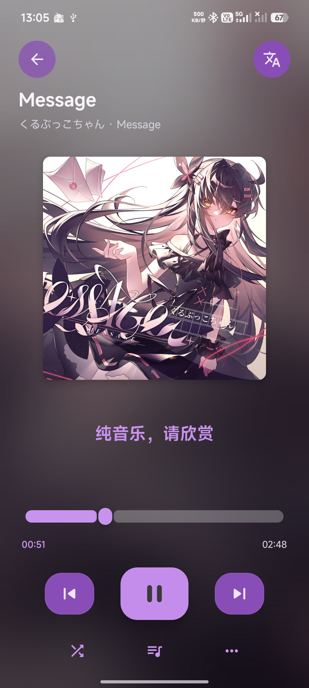
  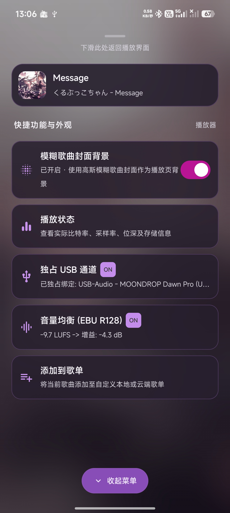
  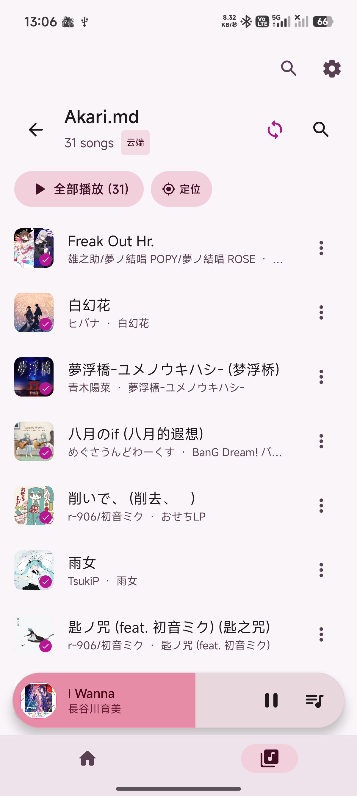
  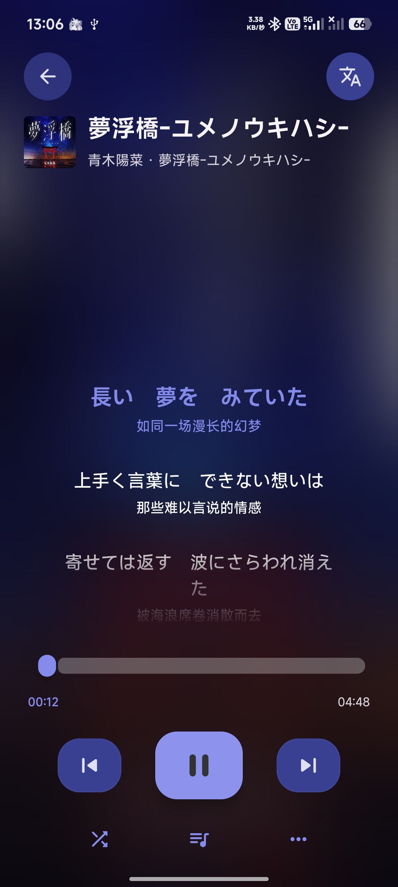
</p>
<p align="center">
  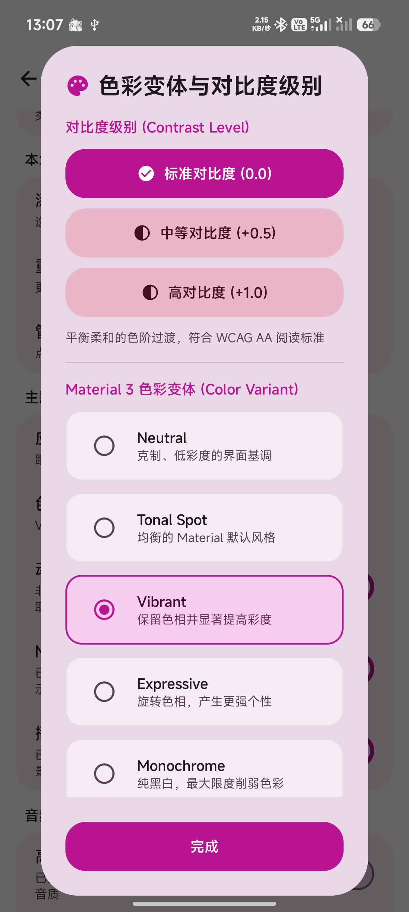
  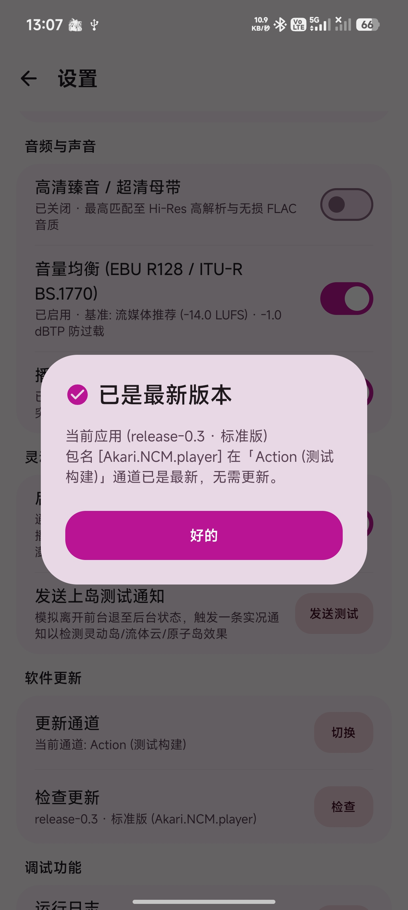
  
  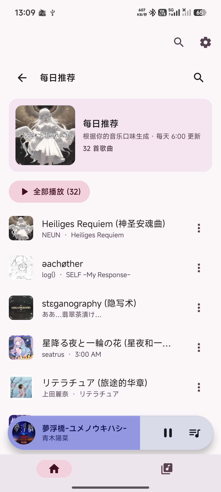
</p>
<p align="center">
  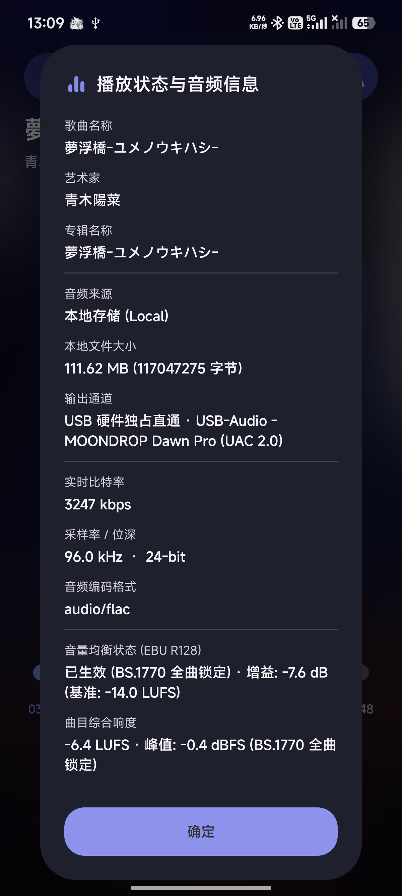
  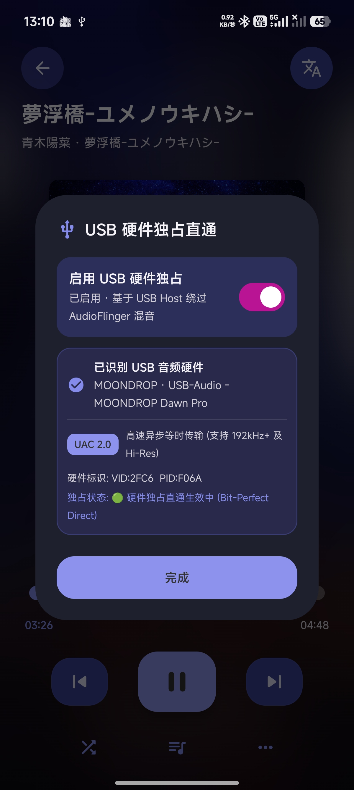
  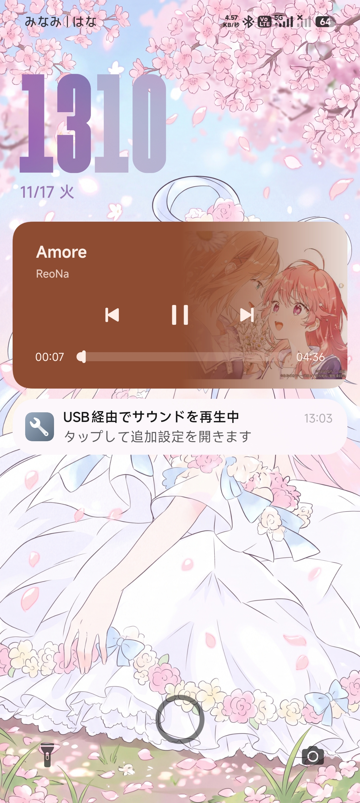
  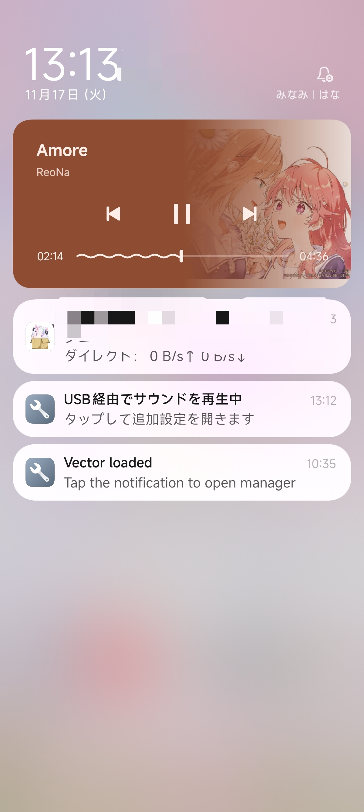
</p>
<p align="center">
  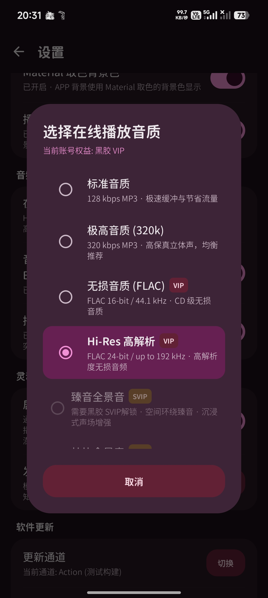
  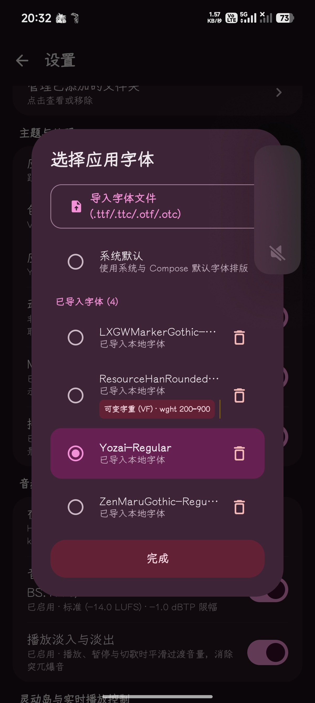
  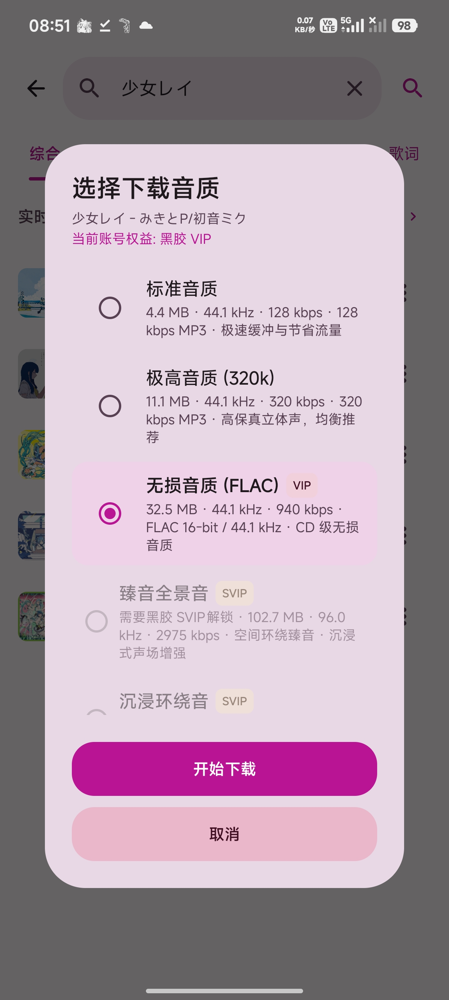
  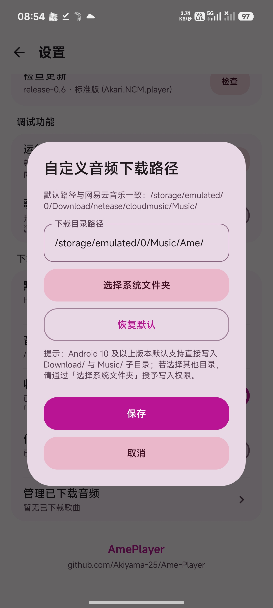
</p>

> HyperOS 上岛效果不代表实际效果，如需达到，请在设备安装 LSPosed 后，使用 [Hyper Helper](https://github.com/HowieHChen/XiaomiHelper) 修改。

---

## 目录

- [项目简介](#项目简介)
- [功能概览](#功能概览)
- [架构与模块](#架构与模块)
- [环境要求](#环境要求)
- [构建与运行](#构建与运行)
- [核心机制](#核心机制)
- [技术栈](#技术栈)
- [鸣谢](#鸣谢)
- [许可声明](#许可声明)

---

## 项目简介

AmePlayer（包名 `Akari.NCM.player`）是一款面向高音质与现代交互体验设计的 Android 网易云 / 本地 / NCM 格式音乐播放器。

- **无后端直连**：内置纯 Kotlin 实现的 WeAPI / EAPI 加解密与传输层，无需自建第三方云端 API 服务即可直连网易云官方接口。
- **高保真音频管线**：支持 NCM 流式解密、EBU R128 三级响度均衡、超高采样率安全降采样与 USB DAC 原生 Bit-Perfect 独占直通。
- **自适应现代 UI**：深度集成 Material 3 Adaptive 自适应导航、AOSP 预测性返回手势、逐字卡拉OK流光歌词与自定义可变字体系统。

---

## 功能概览

### 核心功能

| 功能 | 说明 |
|------|------|
| **端侧网易云直连** | 纯 Kotlin WeAPI/EAPI 协议直连（兼容自定义节点兜底），支持 WebView 登录、启动静默同步云端歌单与云端收藏状态（独立 AES-256 本地加密缓存，云端真源覆盖）及每日推荐 |
| **本地管理与 NCM 解密** | 支持 SAF 多目录扫描与 ID/文本智能匹配，原生 `FileChannel` 流式解密 `.ncm` 并提取封面与内嵌/同目录歌词 |
| **全库搜索与深度浏览** | 支持实时输入预览（Top 5）、综合/单曲/专辑/歌手/歌词分类检索；内部详情返回栈支持歌手（单曲/专辑分页）与专辑多级跳转并保留搜索现场 |
| **播放页与交互** | 云端歌单底部“喜欢”按钮（本地歌单自动隐藏）、可点击跳转的歌手（多歌手内联弹窗选择器）与专辑、快捷功能菜单、下拉/横屏播放队列抽屉与悬浮迷你播放条 |
| **逐字歌词系统** | 支持 AMLL TTML 多镜像竞速与缓存、网易云 YRC 逐字、LRC 翻译合并与 CJK 软分词，提供封面取色流光渲染 |
| **音质与权益控制** | 支持标准 / 极高 (320k) / 无损 (FLAC) / Hi-Res / 高清臻音 / 超清母带选择，结合 VIP / SVIP 权益自动限制与向下安全回退 |
| **EBU R128 响度均衡** | -14 LUFS 目标响度，支持服务端元数据、HTTP Range 11×3s 稀疏抽样与实时 Look-ahead AGC 三级策略及 4x 过采样真峰值限幅 |
| **USB DAC 独占直通** | 原生 C++ 等时传输驱动（UAC 1.0/2.0/3.0），支持 192kHz+ Bit-Perfect 输出、独立独占音量与拔出自动暂停保护 |
| **自定义字体引擎** | 扫描系统字体或 SAF 导入 `.ttf/.ttc/.otf/.otc`，内置 OpenType 解析器识别可变字重 (`fvar` `wght`) 与 `CFF2` 并全局应用 |
| **实况通知 / 灵动岛** | 适配 HyperOS、ColorOS 流体云、OriginOS 原子岛、One UI Now Bar 与 Flyme 状态栏歌词，提供控制中心快捷磁贴 |

---

## 架构与模块

```text
app/src/main/
├── cpp/
│   ├── CMakeLists.txt
│   └── usb-audio-output.h/.cpp        # 原生 USB 等时传输环形缓冲引擎
├── java/com/decent/usbaudio/          # USB Audio Class 直驱与 Media3 AudioSink
└── java/Akari/NCM/player/
    ├── AmeApp.kt / MainActivity.kt    # @HiltAndroidApp 入口与单 Activity 宿主
    ├── core/
    │   ├── Models.kt / NcmModels.kt   # 媒体模型、VipTier / QualityLevel、NcmArtistBrief
    │   ├── PlayerState.kt / Command.kt
    │   ├── font/                      # OpenTypeFontInspector (sfnt/fvar/CFF2 解析)
    │   └── loudness/                  # EBU R128 计算、稀疏 Range 探测与标签解析
    ├── api/
    │   ├── NcmApi.kt                  # 网易云业务 API（直连为主，节点兜底）
    │   ├── NeteaseDirectClient.kt     # WeAPI/EAPI 传输与 Cookie 注入
    │   └── NeteaseCrypto.kt / NeteaseEndpoints.kt
    ├── data/
    │   ├── NcmCrypto.kt / NcmDataSource.kt / NcmFileScanner.kt
    │   ├── CustomFontManager.kt       # 字体扫描、SAF 导入与可变字重 FontFamily 构建
    │   ├── LyricsManager.kt / ttml/   # AMLL TTML / YRC / LRC / 软分词歌词体系
    │   ├── LoudnessManager.kt / LoudnessCacheDatabase.kt
    │   ├── PlaylistManager.kt / LocalFolderManager.kt
    │   └── UserSessionManager.kt / ThemePrefs.kt / UsbAudioManager.kt
    ├── player/
    │   ├── AmePlayerEngine.kt         # Media3 播放引擎、音质缓存键、无限电台
    │   ├── AmePlaybackService.kt      # MediaSession 前台服务
    │   ├── LoudnessAudioProcessor.kt / MaxSampleRateAudioProcessor.kt
    │   └── island/                    # 多厂商实况通知与 Flyme 状态栏歌词
    └── ui/
        ├── theme/                     # AmePlayerTheme (自定义字体注入) 与色彩对比度工具
        ├── component/                 # 逐字歌词、播放队列抽屉、预测性返回、歌曲菜单
        └── screen/                    # MainScreen / PlayerScreen / SearchScreen /
                                       # OnlinePlaylistDetailView / UserHomepageView /
                                       # SettingsScreen / WebViewLoginScreen / LogScreen
```

---

## 环境要求

| 依赖项 | 要求版本 |
|--------|----------|
| **Android Studio** | Ladybug (2024.2) 及以上 |
| **JDK / Gradle** | JDK 21 / Gradle 9.5 |
| **AGP / Kotlin** | AGP 9.1.1 / Kotlin 2.2.10 |
| **Android SDK** | `compileSdk 36` / `minSdk 26` (Android 8.0) / `targetSdk 37` |
| **Native 工具链** | Android NDK + CMake（用于编译 `usb-audio-output`） |

---

## 构建与运行

1. 克隆仓库并进入项目目录：

```bash
git clone https://github.com/Akiyama-25/Ame-Player.git
cd Ame-Player
```

2. 运行单元测试与 Compose UI 测试（使用仓库内 Gradle 9.5）：

```bash
./gradle-9-bin/gradle-9.5.0/bin/gradle.bat testDebugUnitTest
```

3. 构建 Debug 或 Release 通用 APK：

```bash
# 构建 Debug APK
./gradle-9-bin/gradle-9.5.0/bin/gradle.bat assembleDebug

# 构建 Release Universal APK (标准包名 Akari.NCM.player)
./gradle-9-bin/gradle-9.5.0/bin/gradle.bat assembleRelease
```

4. （可选）构建指定伪装包体（用于系统实况通知 / 灵动岛白名单适配）：

```bash
./gradle-9-bin/gradle-9.5.0/bin/gradle.bat assembleRelease -PcustomApplicationId=com.apple.android.music
```

> **提示**：GitHub Actions 工作流（`.github/workflows/build-signed-apk.yml` 与 `release-signed-apk.yml`）依赖仓库配置的签名 Secrets，且运行在 [Instabox](instabox.sh) 上。在 Fork 仓库中构建请自行配置签名变量或使用未签名构建。

---

## 核心机制

### 1. 在线播放音质与 VIP / SVIP 权益策略

- **账号权益感知**：登录后自动查询会员信息，识别普通用户 / 黑胶 VIP / 黑胶 SVIP 等级（`VipTier`），在设置与播放解析阶段将目标音质限制在账号允许的最高规格内。
- **仅向下安全回退**：播放链路基于用户选择与权益上限构造**只降不升**的降级列表（例如 `jymaster -> hires -> lossless -> exhigh -> standard`），并将音质标识纳入 `CacheDataSource` 缓存键（`<songId>#<quality>`），切换音质时自动失效旧缓存。
- **高清臻音独立开关**：在设置中关闭「高清臻音 / 超清母带」后，最高仅请求至 Hi-Res 与无损 FLAC。

### 2. 自定义可变字体引擎

- `OpenTypeFontInspector` 直接解析字体文件的 `sfnt` / `ttcf` 头部与 `fvar` / `CFF2` 表，识别可变字重轴（`wght`）范围并将 Compose `FontWeight`（100–900）分段线性映射至字体轴区间。
- 通过 `CustomFontManager` 统一管理本地系统字体与用户导入字体，并在 `AmePlayerTheme` 中动态替换全局 `Typography`。

### 3. 包体变体与实况通知伪装包

自 **Release-0.3** 起仅提供支持 `arm64-v8a` / `armeabi-v7a` / `x86_64` 的通用包体。针对部分厂商系统的“上岛”白名单限制，提供以下包体变体：

| 包体类型 | 文件名命名格式 | Application ID (包名) |
|---------|--------------|----------------------|
| **标准通用包** | `Ame-Player-<版本号>-signed.apk` | `Akari.NCM.player` |
| **Apple Music 伪装包** | `Ame-Player-<版本号>-Apple_Music-signed.apk` | `com.apple.android.music` |
| **Spotify 伪装包** | `Ame-Player-<版本号>-Spotify-signed.apk` | `com.spotify.music` |
| **网易云音乐 伪装包** | `Ame-Player-<版本号>-Netease_Music-signed.apk` | `com.netease.cloudmusic` |

> [!WARNING]
> 不同包名的 AmePlayer 之间数据不互通，且无法与所伪装的官方应用共存。建议优先使用标准通用包。

---

## 技术栈

### UI

- Jetpack Compose (BOM 2024.12.01) + Material 3 + Material 3 Adaptive (`NavigationSuiteScaffold`)
- Coil Compose（图片异步加载与封面取色）
- AOSP Predictive Back（跨层级预测性返回手势）

### 框架与架构

- Hilt (KSP) 依赖注入
- Kotlin Coroutines + StateFlow / SharedFlow
- KotlinX Serialization + SharedPreferences / SQLite

### 音频与原生层

- Media3 1.5.1 (ExoPlayer / MediaSessionService / CacheDataSource)
- 自定义 `AudioProcessor`（EBU R128 响度均衡 + 超高采样率安全降采样）
- Android NDK + CMake (`usb-audio-output.cpp`) + `UsbAudioSink`

### 网络与测试

- OkHttp（`NeteaseDirectClient` WeAPI/EAPI 直连）+ Ktor 3.0.3（自定义节点兜底）
- Robolectric 4.14.1 + Compose UI Test (JUnit4)

---

## 鸣谢

- **[FlClash](https://github.com/chen08209/FlClash)** — 提供自定义字体管理与可变字体（Variable Font）集成思路参考。
- **[InnerTune](https://github.com/z-huang/innertune)** — 独立播放器界面与沉浸式歌词切换交互参考。
- **[Salt Player (椒盐音乐)](https://github.com/moriafly/SaltPlayerSource)** — 全屏歌词流与播放队列视觉动效参考。
- **[NeteaseCloudMusicApi Enhanced](https://github.com/NeteaseCloudMusicApiEnhanced/api-enhanced)** — 提供网易云音乐 API 结构参考与兼容后端支持。
- **[rinchao0721/Melodia](https://github.com/rinchao0721/Melodia)** — 提供纯 Kotlin 加密直连网易云官方接口的架构与协议参考。
- **[Ma145/decent-player](https://github.com/Ma145/decent-player)** — 提供 USB 独占模式下 192kHz+ 原生输出实现思路参考。
- **应用图标来源** — [kanae3792 (Pinterest)](https://jp.pinterest.com/kanae3792/)

---

## 许可声明

本项目采用 [GPL-3.0 License](LICENSE) 开源，仅供技术学习与交流使用，请勿用于商业用途。
